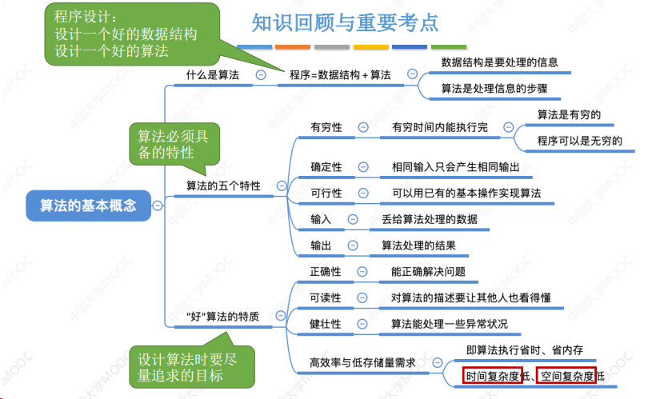

# 数据的存储结构(物理结构)

存储结构是指数据结构在计算机中的表示

存储结构包括:

- 顺序存储: 把逻辑上相邻的元素存储在物理位置也相邻的存储单元中, 元素之间的关系由存储单元的邻接关系来体现
- 链式存储: 逻辑上相邻的元素在物理位置上可以不相邻, 借助指示元素存储地址的指针来表示元素之间的逻辑关系.
-  索引存储: 在存储元素信息的同时, 还建立附加的索引表, 索引表中每项称为索引项, 索引项的一般形式是(关键字, 地址)
- 散列存储: 根据元素的关键字直接计算出该元素的存储地址, 又称哈希(Hash)存储

# 数据的运算
- 数据上的运算包括运算的定义和实现
- 运算的定义是针对逻辑结构指出运算的功能
- 运算的实现是针对存储结构的, 指出运算的具体操作步骤.
针对于某种逻辑结构, 结合实际需求, 定义基本运算.

