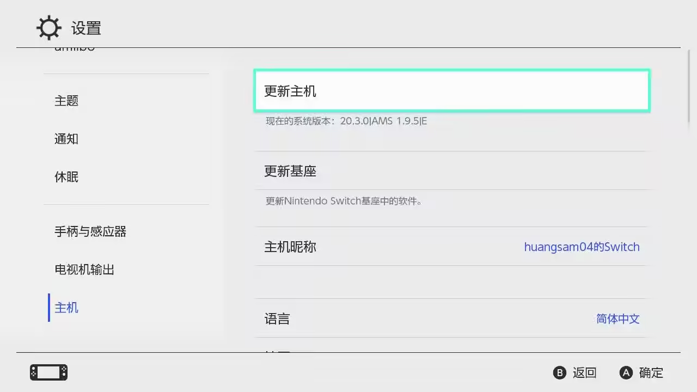

# 可运行的操作系统.

## Horizon OS (HOS)
- 正版系统
- 未经修改的HOS就叫做正版系统(Original Firmware, 缩写OFW, 指原始系统). 正版系统是机身emmc (你可以理解诶为switch中的硬盘)中的系统, Switch新机出厂就有的东西.
- 由于目前没有老任扫盘而ban机的报告, 我们可以认为正版系统启动后不会因为读取TF卡中的可疑数据而ban机
- 因此通过正版系统启动是安全而可靠的.
- 通常认为, 破解并非盗版, 对自己机子进行不侵害他人权益的操作不算违法.

## 大气层破解系统 (Custom Firmware, 缩写CFW)
- 分为大气层真实破解系统, 大气层虚拟系统.

1. 大气层真实破解系统
> 警告: 较为危险, 在了解详情前请不要进入
> 
在开机的时候, 同样也是通过机身自带的emmc来启动系统. 但是同时加载大气层破解文件和各种插件等. 在设置版本里面可以发现版本号最后一位是S.
这个模式主要是用于既想要超频又想要通过正版联机和别人一起玩的人, 或者希望享受正版Switch Oneline服务的人, 或者已经被ban机了直接不演了的人.

因此大部分整合包中, 都不会对这个模式进行隐藏序列号和屏蔽任天堂DNS, 在该模式下机子可以正常连接任天堂服务器.

如果你没有被ban机, 在这个模式下, 应当只做超频, 调整底座模式这些无害且非盗版的功能, 这会被NS系统记录并上传到任天堂服务器, 然后你的机序列号就被ban了.

切记不能安装盗版游戏数据, 不能动存档, 不能开挂.

2. 大气层虚拟破解系统

需要在hekate中创建的一类系统. 在设置版本里面可以发现版本号最后一位是E (例如下图是 20.3.0|AMS 1.9.5|E ）)

这种系统的原理是把机身emmc中自带的系统复制一份, 放到TF卡中. 然后在开机的时候加载TF中的系统, 并加载大气层破解文件和各种插件等.
- 文件格式: 把`emmc`完整的复制一份到TF卡, 例如你是续航版或者lite, 那么就会在TF卡中emuemmc文件夹里写入32Gb的emmc数据.
- 分区格式: 只是把系统写入TF卡, 但是需要把TF卡分区, 其中一个分区将会被模拟成机身储存.
